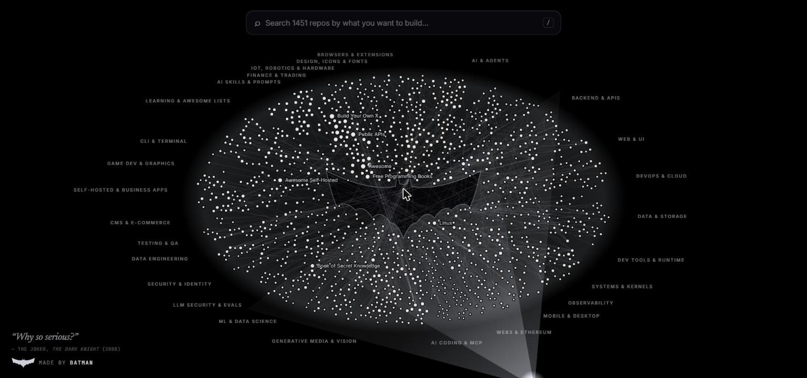

# RepoVerse

**A Bat-Signal map of 1,450+ of the most useful open-source repositories, grouped into 27 niches and searchable by what you want to build.**

**Live demo: https://neverfinished005.github.io/repoverse/**

Instead of digging through dozens of awesome-lists, type what you need ("smart contract testing", "redact PII", "video generation", "self-hosted CRM") and RepoVerse lights up the right repos, shows how they connect, and links you straight to GitHub.




---

## What it does

- **Search by intent.** Plain-language queries are matched against each repo's use cases, tags, niche and description, with synonyms ("eth" → ethereum, "pii" → redaction, "k8s" → kubernetes). Filler words like "I want to build a…" are ignored.
- **Browse by niche.** Click the empty search bar to see all 27 niches with repo counts; pick one and the camera flies to it.
- **See connections.** Hover any point to light up what it works with, depends on, or is an alternative to.
- **Repo details.** Click a point for stars, language, license, year, use cases, tags, connected repos, a GitHub link and a copy-ready `git clone` command.
- **Trace a path** between any two repos (shortest chain through the graph).
- **Blueprints:** ready-made stacks highlighted on the map — Local AI Agent, Ethereum dApp, LLM Data-Leak Guard, Self-Hosted Business Suite, DevSecOps Pipeline and more.
- **MCP console:** an in-browser demo of how an AI agent could query the graph (search, details, path tracing, JSON export).

### How to read the map

| Element | Meaning |
|---|---|
| Point | One repository; bigger = more GitHub stars |
| Slice around the circle | A niche (name on the rim) |
| Distance from the bat | Age within its niche — oldest next to the emblem, newest at the rim |
| Lines | Relationships: works-with, depends-on (dotted), alternative-to (dashed) |

### Niches

AI & Agents · AI Coding & MCP · AI Skills & Prompts · LLM Security & Evals · Generative Media & Vision (video, voice, image) · ML & Data Science · Backend & APIs · Web & UI · Mobile & Desktop · DevOps & Cloud · Data & Storage · Data Engineering · Observability · Dev Tools & Runtime · Systems & Kernels · CLI & Terminal · Testing & QA · Security & Identity · Web3 & Ethereum · Finance & Trading · IoT, Robotics & Hardware · Design, Icons & Fonts · Browsers & Extensions · CMS & E-commerce · Self-Hosted & Business Apps · Game Dev & Graphics · Learning & Awesome Lists

---

## Run it locally

RepoVerse is plain HTML, CSS and JavaScript. There is nothing to install or build to view it — you only need any static file server.

```bash
git clone https://github.com/Neverfinished005/repoverse.git
cd repoverse
```

Then start a server with whichever you have installed:

```bash
# Python 3
python -m http.server 8089

# or Node.js
npx serve -l 8089 .
```

Open **http://localhost:8089** in your browser.

**Live demo:** https://neverfinished005.github.io/repoverse/

### Controls

| Action | How |
|---|---|
| Search | Click the search bar or press `/` |
| Move through results | `↑` `↓`, `Enter` to open |
| Pan | Drag |
| Zoom | Scroll wheel, trackpad pinch, touch pinch, or double-click |
| Open a repo | Click a point |
| Close / step back | `Esc` |

---

## Adding or updating repos

The repo list lives in two seed files, one line per repo:

- `scripts/seed.mjs` — first batch and the original extra niches
- `scripts/seed-more.mjs` — second batch and newer niches

```js
// [niche, 'owner/repo', 'Display Name', 'tags', 'use case; use case', 'relations', 'flags']
['web3', 'foundry-rs/foundry', 'Foundry', 'smart-contracts,testing,solidity', 'test solidity contracts fast; fuzz smart contracts', 'd:solidity,a:hardhat', 'gw'],
```

- **relations:** `w:<id>` works-with, `a:<id>` alternative-to, `d:<id>` depends-on (an id is the display name slugified: `Three.js` → `three-js`)
- **flags:** `mcp` (MCP-ready), `gw` (gateway hub), `y2009` (override the inception year)
- **new niche:** add it to `NEW_CATEGORIES` / `MORE_CATEGORIES` at the top of the seed file

Then regenerate the catalog. This needs [Node.js 18+](https://nodejs.org) and the [GitHub CLI](https://cli.github.com) logged in (`gh auth login`):

```bash
node scripts/build-catalog.mjs
```

The builder checks every repo exists on GitHub (following renames), pulls live stars, description, language, license and creation year, refreshes star counts for the hand-curated repos, and writes `js/catalog.js`. Run it any time to refresh star counts. Repos that can't be found are dropped and listed in the output.

---

## Project structure

```
repoverse/
├── index.html                 # Page: full-screen canvas, search bar, drawer, modals
├── css/style.css              # Dark theme, search, drawer, signature
├── js/
│   ├── data.js                # Hand-curated core repos, niches, relationships, blueprints
│   ├── catalog.js             # AUTO-GENERATED extended catalog (live GitHub data)
│   ├── search.js              # Intent search, synonyms, shortest path, MCP demo tools
│   ├── graph.js               # Canvas renderer: Bat-Signal scene, layout, camera, hit testing
│   └── main.js                # UI controller: search, niche browser, drawer, modals
├── scripts/
│   ├── seed.mjs               # Repo seed list, batch 1
│   ├── seed-more.mjs          # Repo seed list, batch 2
│   └── build-catalog.mjs      # Verifies seeds on GitHub and writes js/catalog.js
└── docs/screenshot.jpg
```

### Performance notes

- Frames are drawn only while something is moving (camera, hover fade, selection pulse); an idle page does no rendering work.
- Layout is computed once in a fixed world space, so resizing never reshuffles points.
- Nodes are drawn in batched paths per colour, hover uses a spatial grid, and off-screen points are culled — around 3–10 ms per frame with 1,450 nodes.

---

## Credits & notes

- Repository metadata (stars, descriptions, languages, licenses) comes from the GitHub API at build time; star counts are a snapshot, not live.
- The bat emblem is an original drawing made for this project. Batman and the Bat-Signal are trademarks of DC Comics; RepoVerse is an unofficial fan-styled project and is not affiliated with or endorsed by DC or Warner Bros.
- Quote: "Why so serious?" — The Joker, *The Dark Knight* (2008).
- Every listed project belongs to its respective authors under its own license.

## License

[MIT](LICENSE)
